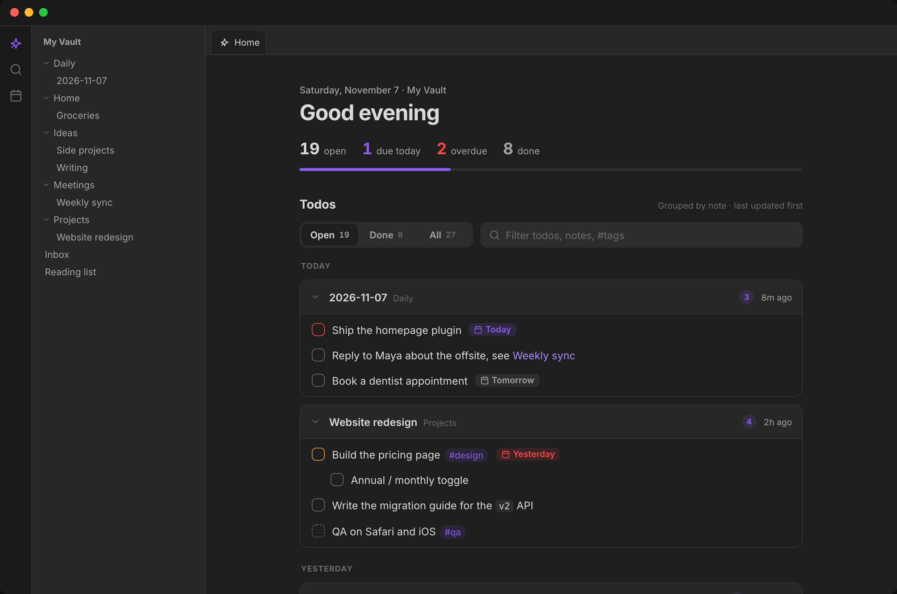
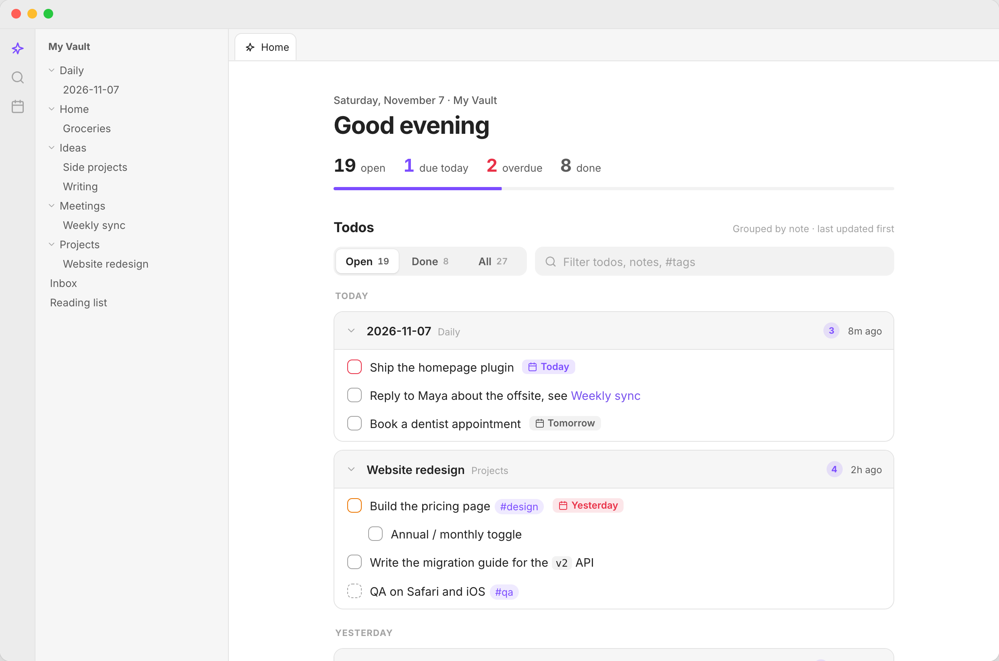
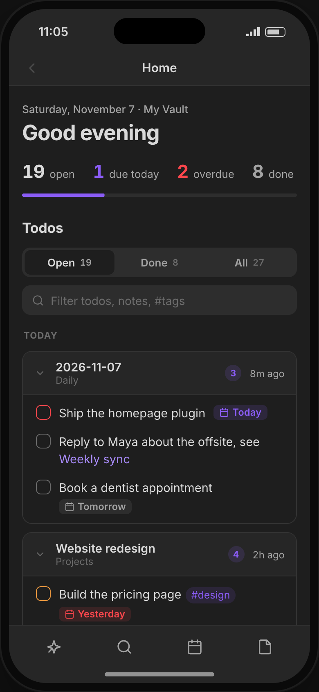
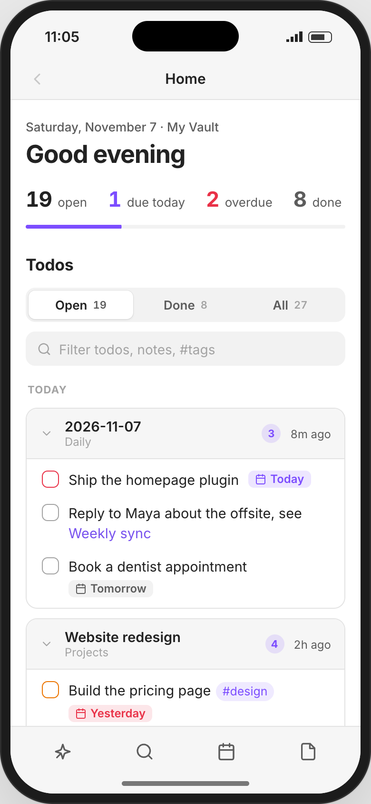

# TODOs rollup for Obsidian

Every todo in your vault, rolled up into one page. Each todo sits under a link to the **note** it came from, and notes are ordered by when they were **last updated**, so whatever you touched most recently is at the top. Tick todos off, filter and search them without opening a single note. Works on desktop and mobile.



| Light theme | Mobile, dark | Mobile, light |
|---|---|---|
| [](docs/desktop-light.png) | [](docs/mobile-dark.png) | [](docs/mobile-light.png) |
| The page follows your Obsidian theme's colours and fonts. | The layout adjusts to the panel width, from a phone to a narrow split. | Bigger tap targets, no stuck hover effects, no iOS zoom on search. |

<sub>Screenshots from the browser demo (`npm start`) with its sample vault.</sub>

## Opening the page

The page opens in a tab called **Todo**, with a checklist icon. There are three ways to get there:

- It opens by itself when the vault starts. Turn this off with **Open on startup** in settings.
- Click the **checklist** icon in the ribbon (desktop) or toolbar (mobile). Its tooltip reads **Open todos**.
- Run **TODOs rollup: Open todos** from the command palette. You can give it a hotkey in **Settings → Hotkeys**.

There is only ever one Todo tab. If it's already open, any of these just switches to it. If the tab in front of you is empty, the page opens there instead of in a new tab.

## What's on the page

From top to bottom:

1. **Header.** Today's date and the vault name, then a greeting that follows the clock: *Good night* (before 5:00), *Good morning* (before 12:00), *Good afternoon* (before 18:00), *Good evening*. The greeting can be turned off.
2. **Counts.** How many todos are **open** and **done**, plus **due today** and **overdue** when there are any (those two tiles hide at zero). A progress bar shows the share of todos that are done.
3. **Filter and search bar.** The Open / Done / All switch and the search box. See [Filtering and searching](#filtering-and-searching).
4. **Todos.** One card per note, grouped by when the note was last updated. See [Note cards](#note-cards).
5. **Recently edited.** Your most recently changed notes, with or without todos, as one-tap shortcuts. You choose how many (3–12) or turn the section off. It hides when there's nothing to show.

## Note cards

Every note with at least one todo gets a card. Cards are sorted by the note's last-modified time, newest first, and grouped under these headings:

| Group | Notes updated |
|---|---|
| **Today** | today |
| **Yesterday** | yesterday |
| **Earlier this week** | 2 to 6 days ago |
| **This month** | 7 to 30 days ago |
| **Older** | 31 or more days ago |

The card header shows:

- **The note's name.** Click it to open the note.
- **Its folder**, in grey. Notes in the vault root show no folder.
- **A badge with the number of open todos** in that note. It disappears when everything in the note is done.
- **When it was last updated**: "just now", "8m ago", "3h ago", "yesterday", "3 days ago", then a date after a week ("Nov 2", or "Nov 2, 2025" for another year). Hover over it for the full date and time. These labels update every minute while the page is open.

Click the **chevron** on the left to collapse a card down to its header. Click again to expand it.

Nested todos stay nested. Subtasks are indented under their parent, and if a parent is filtered out the children move up a level so there are no gaps.

## Todos

Each row is one todo: a checkbox, the text, and a due chip if it has a due date.

- **Click the checkbox** to tick the todo off. `[x]` is written into the note straight away. Click a ticked todo to untick it, which writes `[ ]`.
- **Click the text** to open the note with the cursor on that todo's line.
- **Click a `[[link]]`** inside a todo to open that note. Regular `[links](…)` open in your browser.
- **Click a `#tag`** to search for that tag.
- On desktop, **Cmd-click** (macOS) or **Ctrl-click** (Windows, Linux) any of these to open it in a new tab.

When you tick a todo with the **Open** filter on, the checkbox fills and the text crosses out. After a moment the row slides away, because it no longer matches the filter. The counts update as soon as you click. If your device asks for reduced motion, the row is removed without animation.

**Safe writes.** Before changing the file, the plugin checks that the line still says exactly what it said when the page loaded. If you edited that line in the meantime, nothing is written and you get a notice asking you to try again.

### Task formats

| You write | The page shows |
|---|---|
| `- [ ]`, `* [ ]`, `+ [ ]`, `1. [ ]`, `1) [ ]` | An open todo. Nested lists and todos inside `>` quotes work too. |
| `- [x]` or `- [X]` | Done |
| `- [-]` | Cancelled. Counted as done. |
| `- [/]`, `- [>]`, `- [!]`, `- [?]` or any other character | In progress, shown with a dashed checkbox. Counted as open. |
| `📅 2026-11-10` (Tasks plugin, also `📆` or `🗓`) or `[due:: 2026-11-10]` (Dataview) | A due chip (see below) |
| `🔺` `⏫` `🔼` `🔽` `⏬` or `[priority:: high]` | A coloured checkbox outline for highest, high, medium, low or lowest priority |
| `**bold**`, `*italic*`, `` `code` ``, `==highlight==`, `[[links]]`, `[links](…)`, `#tags` | Rendered inline |

Todos inside YAML frontmatter or code blocks are ignored.

Other Tasks plugin and Dataview markers are hidden to keep the list clean: scheduled `⏳`, start `🛫`, done `✅`, created `➕` and cancelled `❌` dates, recurrence `🔁`, `🆔` and `⛔`, and the matching `[scheduled:: …]`, `[start:: …]`, `[completion:: …]` and `[created:: …]` fields. They stay in your note; they just aren't shown.

**Due chips** read **Today**, **Tomorrow**, a weekday for the next six days ("Fri"), or a date further out. Overdue chips are red and read **Yesterday** or the date. Hover over a chip for the full due date. A done todo's chip turns grey.

## Filtering and searching

The bar above the todos has two controls, and they work together: a todo is shown only if it passes both.

### Open / Done / All

| Filter | Shows |
|---|---|
| **Open** | Open and in-progress todos |
| **Done** | Done and cancelled todos |
| **All** | Everything |

Each button shows its count for the whole vault. The counts don't change when you search. Notes with nothing left to show under the current filter disappear from the list.

### Search box

Type to filter the list as you go. Search is **not case-sensitive** and matches **any part of a word**.

- If the text matches a **note's name or folder**, all of that note's todos are shown (within the current filter). Typing `projects` shows every todo in your Projects folder.
- Otherwise it matches the **todo's text**, as written in the note. That includes hidden metadata, so `2026-11` finds todos with a November 2026 date, and `⏫` finds high-priority todos.
- **Tags:** type `#work`, or click any tag on a todo to fill it in. Because matching is on part of a word, `#work` also finds `#workshop`.
- Press **Esc** to clear the search.

If nothing matches, the page says so and offers a **Clear filter** button.

### Empty states

| When | The page shows |
|---|---|
| The vault has no todos at all | **No todos yet**, with a hint to write `- [ ] something` in any note |
| Filter is **Open** and everything is done | **All clear**, with how many todos you've completed |
| Filter is **Done** and nothing is done yet | **Nothing completed yet** |
| A search matches nothing | **No todos match "…"** and a **Clear filter** button |

## What's remembered

| State | Remembered |
|---|---|
| **Open / Done / All filter** | **Yes.** Saved in the plugin settings, so the page reopens on the filter you last used, after restarts too and on every device the settings sync to. |
| **Search text** | **No.** Starts empty each time the page opens. |
| **Collapsed cards** | **While the page stays open.** Survives edits and refreshes, but resets when you close and reopen the page, restart Obsidian, or change a setting. |
| **Settings** | **Yes.** Stored in `.obsidian/plugins/todos-rollup/data.json`. Changing a setting redraws the page right away. |

## Staying up to date

The page refreshes by itself, about a third of a second after any of these:

- you edit a note (including one that just gained or lost a todo)
- a note is renamed, moved or deleted
- Obsidian finishes indexing the vault
- you switch back to the Todo tab

So you can edit a note in a split next to the page and watch the todo appear. Only notes that Obsidian's index says contain tasks are read, so this stays fast on large vaults.

## Desktop and mobile

- **Desktop:** notes open in a new tab by default, so the Todo tab stays open. Turn off **Open notes in a new tab** to open them in the same tab instead.
- **Mobile:** notes always open in place, and Back returns you to the page.
- The layout follows the width of the panel, not the device, so it also works in a narrow desktop split.
- Touch screens get bigger tap targets, no stuck hover effects and no grey tap flash. The search box doesn't make iOS zoom in.
- No desktop-only code (`isDesktopOnly: false`), and the bundle runs on older iOS versions too.

## Settings

| Setting | What it does | Default |
|---|---|---|
| Open on startup | Show the page when the vault opens | On |
| Open notes in a new tab | Desktop only. On mobile, notes always open in place. | On |
| Show greeting | The "Good morning" heading | On |
| Show recently edited notes | The Recently edited section | On |
| Recently edited count | How many recent notes to show (3–12) | 6 |
| Excluded folders | Folders to ignore, one per line. Subfolders are excluded too. | `Templates` |
| Excluded note names | File names to ignore in every folder, one per line. Not case-sensitive. | `AGENTS.md`, `SKILL.md` |

Excluded folders and note names are left out everywhere: the todo list, the counts and Recently edited.

## Development

```bash
npm install
npm start            # browser demo at http://localhost:5199 (same as npm run demo)
npm test             # colocated unit tests (*.test.ts) plus architecture rules
npm run dev          # watch build of the real plugin (main.js)
npm run lint         # Oxlint: correctness, layer boundaries, no innerHTML
npm run typecheck    # TypeScript check (including tests)
npm run check        # lint + typecheck + tests
npm run build        # type-check + production build of the plugin
npm run demo:build   # static build of the demo in demo-dist/
```

### Architecture

The code is split into DDD layers. Dependencies point inward, and only `infrastructure/` (and the entry point `main.ts`) may import `obsidian`. `src/architecture.test.ts` enforces this. See `docs/architecture.md`.

```
src/
  domain/              the todo model and its rules; pure, no I/O, no DOM
    task.ts            Task, status, filter rules
    task-parser.ts     finds todos in a note
    task-toggle.ts     flips a checkbox safely
    task-text.ts       due dates, priorities, links, tags
    calendar.ts        day buckets and due-date urgency
    settings.ts        settings model, validation, exclusion rules
    ports.ts           NoteRepository, NoteOpener, Notifier, Clock
  application/
    todo-board.ts      loads notes, holds filter/search/pending state, toggles todos
  presentation/        framework-free DOM components (shared by plugin and demo)
    todo-page.ts       lays out the page and wires board events to components
    header.ts toolbar.ts todo-list.ts note-card.ts task-row.ts task-tokens.ts recent-notes.ts
    format.ts dom.ts context.ts
  infrastructure/obsidian/
    vault-note-repository.ts   NoteRepository over the vault
    workspace-note-opener.ts   NoteOpener over the workspace
    todo-view.ts settings-tab.ts
  main.ts              plugin entry and composition root
styles.css             all styles, built on Obsidian's theme variables
demo/                  sample vault, mock Obsidian window and phone, in-memory NoteRepository
scripts/install.mjs    copies the build into a vault
```

Tests sit next to the code they cover (`*.test.ts`). They are excluded from the production type-check (`tsconfig.build.json`) and never reach the bundle.

### Browser demo (`npm start`)

The demo runs the shared domain, application and presentation layers against an in-memory vault (`demo/vault.ts`) inside a mock Obsidian window, so Obsidian isn't needed and the page looks and behaves exactly like the real plugin.

- Use the bar at the top to switch between **Desktop** and **Mobile**, and between **Light** and **Dark**.
- Tick off a todo: it fills in, crosses out, then slides away.
- Click a todo's text to open its note with that line selected.
- Edit a note and go back to the Todo tab: your changes are already there.
- Click **Reset** to bring back the sample notes.

You can link straight to a view, for example `http://localhost:5199/?device=mobile&theme=light`.

### Installing into a local vault

```bash
npm run build
npm run install-plugin -- /path/to/vault   # copies main.js, manifest.json, styles.css
```

This copies the build into `<vault>/.obsidian/plugins/todos-rollup/`. Then go to **Settings → Community plugins**, turn off Restricted mode if needed, and enable **TODOs rollup**. To install by hand, copy the same three files into that folder.

For development, symlink this folder into `<vault>/.obsidian/plugins/todos-rollup` instead, run `npm run dev`, and reload Obsidian (or use the Hot Reload plugin). Use the copy when the vault syncs to other devices, since a synced symlink points nowhere there.

**On your phone:** if your vault syncs (Obsidian Sync, iCloud, Syncthing and so on), the plugin folder syncs with it. Enable **TODOs rollup** in **Settings → Community plugins** on the phone too. With Obsidian Sync, turn on **Settings → Sync → Installed community plugins**.

### Design

The interface follows [Emil Kowalski's design-engineering guidelines](https://github.com/emilkowalski/skills):

- Animations are short (under 300ms) and use strong ease-out curves. Nothing animates from zero size.
- Buttons and checkboxes shrink slightly when pressed, so every tap gets instant feedback.
- Hover effects only apply with a mouse or trackpad, so nothing gets stuck after a tap on a phone.
- Numbers use fixed-width digits so counts don't jump when they change.
- If your device asks for reduced motion, movement is turned off.

## Contributing

Issues and pull requests are welcome. See [CONTRIBUTING.md](CONTRIBUTING.md) and the [Code of Conduct](CODE_OF_CONDUCT.md). To report a security problem, see [SECURITY.md](SECURITY.md).

## License

[MIT](LICENSE) © 2026 David Peled
